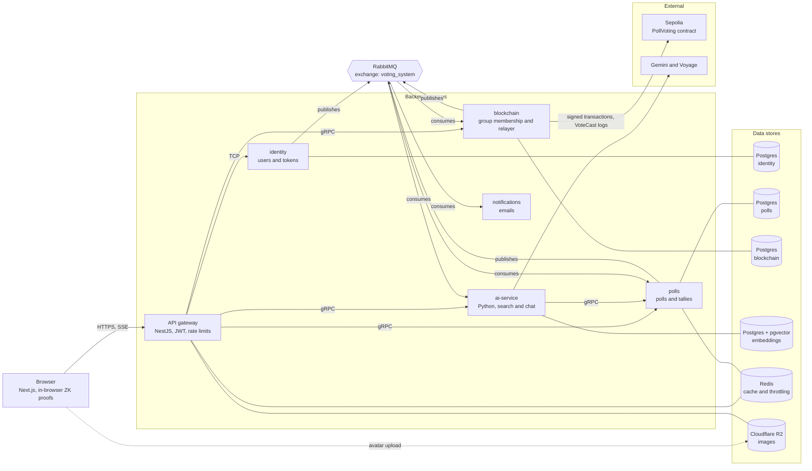
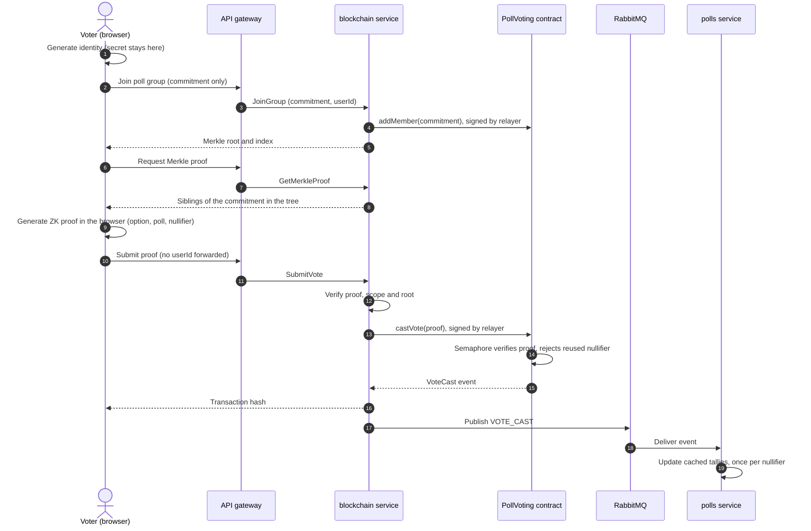
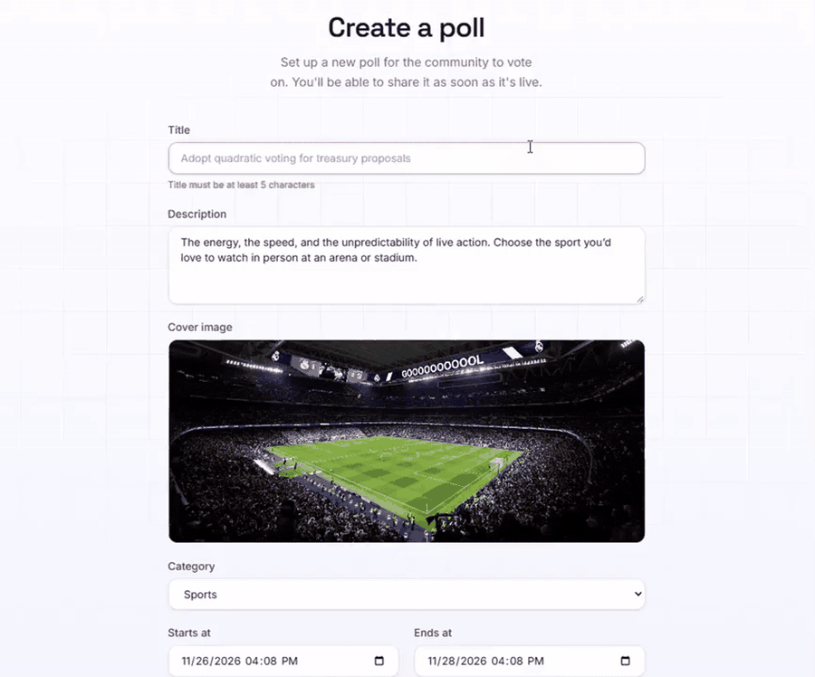
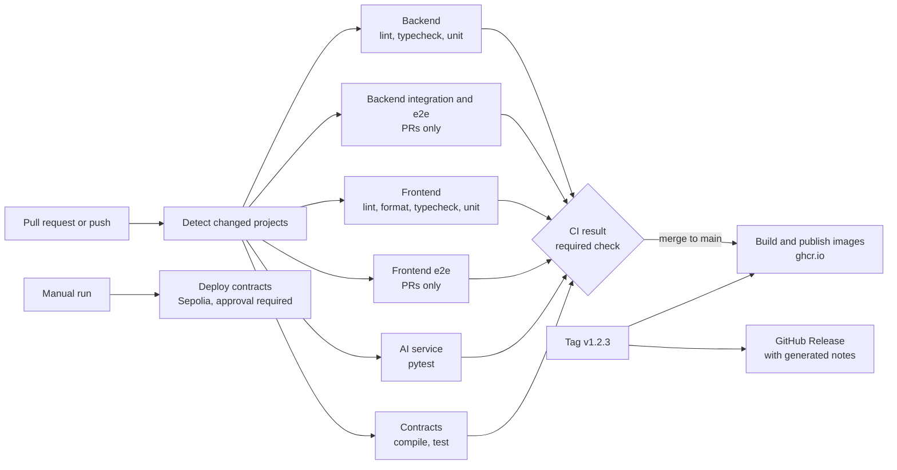

<div align="center">


# Web3 Voting System

**Anonymous, verifiable polls on Ethereum.**
Every vote is a zero-knowledge proof: anyone can check the tally on-chain, and nobody can tell who voted for what.

[](https://github.com/Nikolla2000/Web3-Voting-System/actions/workflows/ci.yml)
[](https://github.com/Nikolla2000?tab=packages&repo_name=Web3-Voting-System)


<br />


</div>

## Table of contents

1. [About](#about)
2. [Highlights](#highlights)
3. [Architecture](#architecture)
4. [How anonymous voting works](#how-anonymous-voting-works)
5. [Features](#features)
6. [Under the hood](#under-the-hood)
7. [Testing and CI/CD](#testing-and-cicd)
8. [Running locally](#running-locally)
9. [Challenges and solutions](#challenges-and-solutions)
10. [What I learned](#what-i-learned)
11. [Credits](#credits)
12. [License](#license)

## About

Web3 Voting System is a polling platform where voting is private by construction rather than by policy. You sign in with an ordinary account, pick a poll and vote. Your browser generates a [Semaphore](https://semaphore.pse.dev/) zero-knowledge proof that says "I am a registered member of this poll's group and I haven't voted yet" without saying which member. A relayer submits the proof to a smart contract on the Sepolia testnet, the contract verifies it, and the tally is updated. The platform can't link a vote to an account, and neither can anyone reading the chain.

It is also a deliberately broad portfolio project. It is built as a set of microservices that talk over different protocols (HTTP, TCP, gRPC, RabbitMQ), with a Solidity contract, a Python AI service and a full CI/CD pipeline around them, to show how these pieces fit together in one working system.

> The contracts live on the **Sepolia testnet** only. There is no real money involved and nothing here is audited for production elections.

<div align="center">

</div>

## Highlights

- **Anonymous voting with zero-knowledge proofs.** Semaphore proofs are generated in the browser, so the server never sees which voting identity belongs to which account.
- **One vote per person, enforced.** Each account can join a poll's group once, and the contract rejects a reused nullifier, so double voting fails without revealing the voter.
- **Verifiable on-chain.** Every vote is a transaction you can open on Etherscan, and the tally in the app is derived from the contract's own events.
- **Six services, four protocols.** REST at the edge, TCP, gRPC and RabbitMQ pub/sub inside, each used where it fits the job.
- **AI-assisted polls.** Duplicate detection with pgvector, a neutrality check for loaded wording, natural-language search and a Q&A chat agent.
- **Cached and rate limited.** Redis cache-aside with version-based invalidation, and per-endpoint rate limits backed by a Lua script.
- **Tested end to end.** Unit, integration and Docker-backed e2e suites, plus Playwright runs that generate a real in-browser proof.
- **Shipped like a product.** Path-filtered CI, production images published to GHCR, tagged releases and a gated Sepolia deploy workflow.

## Architecture

The browser only ever talks to the API gateway. Behind it, each service owns one job and its own database, and the services find out about each other's work through RabbitMQ events.

> **A note on the choices.** Microservices are not the ideal architecture for a project this size, and a single well-structured application would be simpler to build and run. I chose them because I wanted hands-on experience with this style: several services, separate databases, and different ways of communicating between them. The same goes for several other technologies here. Where a choice was made to learn something rather than because it was the best fit, I say so.



### Services

| Service | Role | Talks over | Data |
|---|---|---|---|
| `frontend` | Next.js app, generates voting identities and ZK proofs in the browser | HTTP to the gateway | none |
| `api-gateway` | The only public entry point: REST, Swagger, JWT checks, validation, rate limiting, poll cover uploads | HTTP in, TCP and gRPC out | Redis, R2 |
| `identity` | Registration, login, Google OAuth, refresh tokens, profile, avatars | TCP | Postgres (Prisma), R2 |
| `polls` | Poll CRUD, listing and search filters, cached vote tallies | gRPC | Postgres (Prisma), Redis |
| `blockchain` | Semaphore group membership, proof verification, the relayer that signs every on-chain transaction, and the indexer that reads vote events back | gRPC | Postgres (Prisma), Sepolia |
| `ai-service` | Duplicate detection, neutrality check, natural-language search, Q&A agent | gRPC | Postgres with pgvector |
| `notifications` | Welcome emails, driven only by events | RabbitMQ consumer | none |
| `contracts` | `PollVoting.sol`, a thin wrapper around the Semaphore contract, shared by all polls | n/a | Sepolia |

### Events

The services that don't call each other directly are connected by a handful of events on one RabbitMQ topic exchange:

| Routing key | Published by | Consumed by | Effect |
|---|---|---|---|
| `USER_REGISTERED` | identity | notifications | Sends the welcome email |
| `POLL_CREATED` | polls | blockchain, ai-service | Creates the poll's on-chain group; indexes the poll's embedding |
| `POLL_CONTRACT_DEPLOYED` | blockchain | polls | Stores the contract address on the poll |
| `VOTE_CAST` | blockchain | polls | Updates the cached tallies, once per vote |

### Why the protocols differ

The mix is intentional. Part of the goal of the project is to show each style in a working system, so the choices are not claimed to be the only sensible ones.

- **REST** is what browsers speak, so it exists only at the gateway.
- **TCP** (Nest microservice transport) covers `identity`, a small request and response service where a typed contract buys little.
- **gRPC** with `.proto` files covers the services with richer contracts, including streaming for the chat answer, and it is what lets a Python service and a TypeScript one share a schema.
- **RabbitMQ** carries anything that is a fact about the past rather than a request, like "a poll was created". Several independent services react to the same event without the sender knowing about them.

The gateway is also the single JWT authority. Downstream services trust the `userId` it forwards, which keeps authentication logic in one place.

## How anonymous voting works

The short version: the platform knows **who is allowed to vote**, the blockchain knows **what was voted**, and nothing connects the two.

<div align="center">

</div>

### The idea in plain English

1. **A secret you generate yourself.** The first time you vote in a poll, your browser creates a random [Semaphore](https://semaphore.pse.dev/) identity: a secret key plus a public fingerprint of it, called a commitment. The secret never leaves your browser.
2. **Joining the poll's group.** You send only the commitment to the server. It checks that your account hasn't joined this poll before (one account, one commitment per poll), and the relayer adds the commitment to the poll's group on the Sepolia contract. The group is a Merkle tree of everyone who may vote.
3. **Proving membership without revealing who you are.** Your browser builds a zero-knowledge proof that says "I know a secret whose commitment is somewhere in this group, and I choose option X". The proof doesn't say which member you are.
4. **Voting once.** The proof also carries a nullifier, a value derived from your secret and the poll. It is the same every time you vote in that poll and unlinkable to your commitment, so the contract can reject a second vote without knowing who cast the first.
5. **Anonymous sender.** The relayer, a single backend-owned account, submits the transaction. Every vote on every poll comes from the same address, so the sender tells you nothing about the voter.

### Vote flow



Two details that make this hold together:

- **Poll and option IDs become field elements.** Semaphore works with numbers in a finite field, not UUIDs. The poll ID becomes the proof's scope and the option ID becomes its message, converted by the same function in the browser and in the backend. If the two sides ever disagree, proof verification fails.
- **The Merkle tree is rebuilt from rows.** The `blockchain` service keeps each poll's tree in memory, but the source of truth is the `GroupMember` table, so a restart never invalidates the membership or the proofs already issued.

### What is and isn't private

| Private | Not hidden |
|---|---|
| Which commitment cast which vote | The result: every vote and its chosen option is public on-chain |
| Any link between an account and its vote | That an account joined a poll's group, because the server stores the account to commitment link to enforce one vote per person |
| The identity secret, which never leaves the browser | Timing: joining and voting happen seconds apart from the same session, which matters in small groups |
| The voter's own address, since the relayer sends everything | The relayer: a malicious operator could log IP addresses and request times |

Other honest limits:

- **The voting identity lives in `localStorage`.** Clearing site data, or switching browser, after joining means you can't vote in that poll any more, since your account has already used its one slot.
- **Small groups give weak anonymity.** A group with one member is trivially identifiable. The guarantee gets stronger as more people join.
- **Sepolia testnet only.** The contracts are the standard Semaphore ones plus a thin owner-restricted wrapper, but nothing here has been audited.

## Features

### Accounts

- Email and password registration with validation, and Google sign-in.
- Short-lived access tokens held in memory only, plus a rotating refresh token in an httpOnly cookie. Refreshes are single-flight, so parallel requests never race each other with a used token.
- Profile page: account details, password change, avatar upload straight to R2 with a presigned URL, sign out everywhere and account deactivation behind a typed confirmation.
- Welcome email sent asynchronously through RabbitMQ.

### Polls

- Create polls with a title, description, category, schedule, cover image and two or more unique options.
- Browse with text search, status filters (all, active, upcoming, ended), sorting and pagination.
- Live vote bars on each card and on the poll page, refreshed automatically while a poll is active.
- Cover images are uploaded as pending files and only attached to the poll once it is created, so abandoned uploads expire on their own.

### Voting

- One anonymous vote per account per poll, using a Semaphore proof generated in the browser. See [How anonymous voting works](#how-anonymous-voting-works).
- A step-by-step progress indicator while the identity is registered, the proof is generated and the transaction is submitted.
- A transaction hash with a link to Etherscan once the vote is on-chain.

### AI assistance

- **Duplicate detection.** While you write a poll, its title and description are compared with existing polls using pgvector similarity, and you see the closest match with a percentage.
- **Neutrality check.** Flags loaded or leading wording in the title and options and suggests rewrites. It runs in parallel with the duplicate check and both land in one warning panel.
- **Natural-language search.** Type something like "climate polls from last month" and the model extracts a topic plus category and date filters for a single vector and SQL query.
- **Q&A chat.** A tool-calling agent that answers questions about polls by reading live data, streamed to the browser over Server-Sent Events.

<div align="center">

</div>

<!-- TODO: add a GIF or screenshot of the AI chat once the chat error is fixed. -->

## Under the hood

Each choice below is there for a reason, and a few are there mainly to show a different technique.

### Frontend

| Tool | Why |
|---|---|
| Next.js 16 and React 19 | App Router, and a standalone build that makes the production image small (about 300 MB). |
| Tailwind CSS v4 and shadcn-style components | Every UI element is its own small component, with no template-library look. |
| TanStack Query | Server state, caching and the active-poll refetch, instead of hand-written loading flags. |
| Zustand | A tiny in-memory store for the access token, which must never touch `localStorage`. |
| react-hook-form and zod | One schema validates a form and types it. |
| Semaphore JS packages | Identity creation and Groth16 proving in the browser, so the secret never leaves it. |
| Axios with an interceptor | Attaches the token and retries once through the refresh endpoint on a 401. |

### Backend

| Tool | Why |
|---|---|
| NestJS monorepo | Several apps share one `libs/shared` for constants, DTOs, proto files and the RabbitMQ and R2 wrappers. |
| Prisma and PostgreSQL | A separate database per service, so no service reads another's tables. |
| gRPC (`@grpc/grpc-js`) | Strongly typed contracts shared with the Python service, plus streaming for the chat. |
| Raw `amqplib` | This is publish and subscribe with independent consumers, not request and reply, which is what Nest's built-in RMQ transport is for. |
| Redis (ioredis) | Cache-aside for poll data and storage for rate-limit counters, via a Lua script. |
| Cloudflare R2 | S3-compatible image storage with a separate bucket and scoped token per service. |
| viem | Typed contract calls, transaction signing and event watching for the relayer. |
| `@semaphore-protocol/*` | Group and Merkle proof handling, and off-chain proof verification before spending gas. |
| Passport, JWT and bcrypt | Google OAuth and password sign-in, with the gateway as the only token authority. |
| Swagger | Generated API docs at the gateway. |

### Smart contracts

| Tool | Why |
|---|---|
| Solidity 0.8.23 | `PollVoting` is a thin wrapper that adds poll bookkeeping to Semaphore. |
| Semaphore | An audited, widely used protocol for anonymous membership proofs, instead of a home-made one. |
| OpenZeppelin `Ownable` | Only the relayer can create polls and add members, while anyone can submit a valid proof. |
| Hardhat 3 and viem | Compilation and tests, using the same client library as the backend. |
| Hardhat Ignition | Repeatable deployments, with the Sepolia deployment record committed so a redeploy is a no-op. |

### AI service

| Tool | Why |
|---|---|
| Python 3.12 and uv | Fast, locked, reproducible environments. |
| Voyage embeddings | A generous free tier and a good retrieval model for short texts. |
| pgvector | Similarity search inside the same Postgres as the rest of the service's data, with no separate vector database. |
| Gemini | The model behind search parsing, the neutrality check and the chat agent. |
| `grpclib` | A pure-Python gRPC implementation, wire-compatible with the Node client. |
| SQLAlchemy and Alembic | Async access and versioned migrations. |

### Infrastructure

| Tool | Why |
|---|---|
| Docker Compose | One command for the local databases, and a production file that runs published images. |
| GitHub Actions | Path-filtered CI, image publishing, releases and a gated deployment. See [Testing and CI/CD](#testing-and-cicd). |
| GitHub Container Registry | Hosts the production image of each service, tagged by commit and by version. |
| CloudAMQP, Upstash and Cloudflare R2 | Hosted free tiers for the broker, Redis and storage, so there is less to run locally. |

## Testing and CI/CD

### Test suites

| Project | What runs | Notes |
|---|---|---|
| Backend | Jest unit tests, integration tests and gateway e2e tests | The slow suites start real Postgres and RabbitMQ containers with Testcontainers, so they exercise real wiring rather than mocks. |
| Frontend | Vitest and React Testing Library | Tests mock at the network edge by swapping Axios's adapter, so the real interceptors and token refresh logic run. |
| Frontend e2e | Playwright in Chromium, against a production build | A stateful in-memory gateway answers the requests, and the vote test generates a real zero-knowledge proof and checks it with the backend's own field-element conversion. |
| AI service | pytest | Covers the search, duplicate and chat logic. |
| Contracts | Hardhat tests | Covers poll creation, adding members and the owner-only restriction. |

### Pipeline

Every push and pull request goes through the same flow. Only the projects whose files changed are tested, and the slow suites (Docker-backed backend tests and Playwright) run on pull requests only.



- **`CI result` is the only required check** on `main`. It succeeds when every job that was meant to run passed, and skipped jobs for untouched projects don't block a merge.
- **Docker images.** Each of the seven services has a production Dockerfile. Pushes to `main` publish `latest` and a commit tag, and version tags publish the version. The frontend image is about 300 MB thanks to Next's standalone output.
- **Releases.** Pushing a `v*` tag creates a GitHub Release whose notes are generated from the merged pull requests. Tags with a suffix, like `v1.0.0-rc.1`, are marked as pre-releases.
- **Contract deployment.** A manual workflow that only runs from `main`. It waits for approval in the `sepolia` environment, keeps the secrets there and resumes from the committed deployment record, so an unchanged module deploys nothing.

## Running locally

### Prerequisites

- Docker with Compose
- Node.js 24 and Python 3.12 with [uv](https://docs.astral.sh/uv/), only if you want to run services outside Docker
- A funded Sepolia wallet for the relayer (testnet ETH is free from a faucet)

Some pieces are hosted rather than self-run, all with free tiers:

| For | Service |
|---|---|
| Message broker | [CloudAMQP](https://www.cloudamqp.com/) |
| Cache and rate limits | [Upstash Redis](https://upstash.com/) |
| Image storage | [Cloudflare R2](https://www.cloudflare.com/developer-platform/products/r2/) |
| Sepolia access | An RPC URL, for example from Alchemy or Infura |
| Embeddings | [Voyage AI](https://www.voyageai.com/) |
| LLM | [Google Gemini](https://ai.google.dev/) |
| Optional | A Google OAuth client for Google sign-in, and an SMTP account for welcome emails |

### 1. Deploy your own contract

Only the relayer's address can add members to a poll, so you need your own deployment rather than the one this project used.

```bash
cd contracts
npm ci
# .env: SEPOLIA_RPC_URL, DEPLOYER_PRIVATE_KEY, RELAYER_ADDRESS, ETHERSCAN_API_KEY
npm run deploy:sepolia
```

Copy the printed `PollVoting` address for the next step. `RELAYER_ADDRESS` must be the address of the key you give the `blockchain` service below.

### 2. Configure the services

Each project reads its own `.env` file. Docker Compose reads database credentials from a root `.env`.

| File | Main variables |
|---|---|
| `.env` (repo root) | `IDENTITY_DB_USER`, `IDENTITY_DB_PASSWORD`, and the same pair for `POLLS`, `BLOCKCHAIN` and `AI` |
| `backend/.env` (gateway) | `JWT_ACCESS_SECRET`, `JWT_REFRESH_SECRET`, `REDIS_URL`, `RABBITMQ_URL`, `R2_*`, `FRONTEND_URL`, Google OAuth settings, service hosts and ports |
| `backend/apps/identity/.env` | database URL, JWT secrets and expiry, `RABBITMQ_URL`, `R2_*` |
| `backend/apps/polls/.env` | database URL, `REDIS_URL`, `RABBITMQ_URL` |
| `backend/apps/blockchain/.env` | database URL, `RPC_URL`, `RELAYER_PRIVATE_KEY`, `POLL_VOTING_CONTRACT_ADDRESS`, `RABBITMQ_URL` |
| `backend/apps/notifications/.env` | `RABBITMQ_URL`, `EMAIL_*` |
| `ai-service/.env` | see `.env.example`: `DATABASE_URL`, `RABBITMQ_URL`, `VOYAGE_API_KEY`, `GEMINI_API_KEY` |
| `frontend/.env` | `NEXT_PUBLIC_API_GATEWAY_URL` |

### 3. Start everything

```bash
docker compose up
```

This starts the four databases and every service with hot reload. When it settles:

| URL | What |
|---|---|
| http://localhost:5000 | The app |
| http://localhost:3000/docs | Swagger docs for the gateway |

### Run the published images instead

To run the production images without building anything, pick a tag from the releases page, or use `latest`:

```bash
IMAGE_TAG=latest docker compose -f docker-compose.prod.yml up
```

### Run the tests

```bash
cd backend   && npm test && npm run test:integration && npm run test:e2e   # the last two need Docker
cd frontend  && npm test && npm run test:e2e
cd ai-service && uv run pytest
cd contracts && npx hardhat test
```

## Challenges and solutions

### Learning to build across service boundaries

This was my first microservices project, and almost nothing about it resembled a normal HTTP backend. Every boundary had its own rules for how data and errors travel:

- **Errors changed shape at every hop.** A plain `NotFoundException` thrown in `identity` doesn't survive the TCP transport, and gRPC services report numeric status codes, not HTTP ones. The fix was two layers: services throw RPC-safe exceptions that carry a status, and one global filter in the gateway turns each kind (HTTP, TCP errors, gRPC status codes) into a consistent HTTP error for the client.
- **Only the gateway shapes responses.** Services return plain data, and the gateway wraps it in the standard response envelope, so the clients see one format no matter which protocol served the request.
- **Protocol quirks.** For example, proto3 silently drops fields that hold default values, so gRPC clients need `loader: { defaults: true }` or a zero or empty value just disappears from the response.
- **Events add a new failure mode.** RabbitMQ delivers at least once, so consumers have to tolerate duplicates. The vote tally uses a unique constraint on `(pollId, nullifierHash)` and swallows the duplicate-key error, which makes redelivery harmless.

Learning when each protocol fits, and where the translation between them belongs, was the biggest lesson of the project.

### Making the voting flow work end to end

The voting flow was the hardest part. It touches zero-knowledge proofs, Merkle trees, a smart contract, a relayer and an event pipeline, and each piece has to agree with the others exactly. The key was deciding where each fact lives:

- **Who may vote** is the poll's Semaphore group, which exists on-chain and as a mirror in the `blockchain` service.
- **What was voted** lives on the contract. The `polls` database only keeps cached tallies, built from the contract's `VoteCast` events.
- **Who already voted** is never stored as an account list. The nullifier does that job: the contract rejects a reused one, and the tally ignores a repeated one.

Getting the vote flow right meant understanding the pieces first, then wiring them one at a time, with the e2e test generating a real proof to make sure the browser and the backend agree.

### A UUID that wouldn't fit in a proof

Semaphore's proof takes a `scope` (the poll) and a `message` (the chosen option), and I wanted those to be the poll and option UUIDs. Passing the UUID as a string failed: the library converts strings with `encodeBytes32String`, which rejects anything over 31 bytes, and a UUID is 36 characters.

The fix was to skip the string path. Removing the dashes leaves 32 hex characters, which is 128 bits, well inside the field, so the UUID can be passed as a `bigint` directly. The same function turns it back into a UUID when the contract's events are read. The catch is that the browser and the backend have to implement it identically, or every valid vote fails verification. They live in separate npm projects, so the function is duplicated on purpose with a comment pointing at the other copy, and the Playwright vote test verifies a real proof against the backend's own implementation.

### A Merkle tree that survives restarts

Semaphore proofs need the group's Merkle tree, and that tree is an in-memory object. The first design question was where to keep it. Putting it in Redis would mean rebuilding it into a `Group` before every operation, and a stale copy would silently break voting.

The solution was to treat the `GroupMember` table as the source of truth and the tree as a cache. The service rebuilds a poll's tree from the rows in index order the first time it's needed and keeps it per poll in memory. A restart costs one rebuild and loses nothing, and proofs already issued stay valid because the same members in the same order produce the same root.

### Cache invalidation for a listing with too many keys

The polls list can be filtered, searched, sorted and paginated, so the number of distinct queries is huge. Caching it is easy, but invalidating it when a vote arrives is not: a single write could affect any of them, and scanning Redis to delete matching keys is slow and error-prone.

The solution was to put a version number inside every cache key. Creating a poll, tallying a vote or deploying a contract just increments the version, which orphans every cached listing at once in constant time. The old entries expire on their own after 30 seconds. Poll detail pages use the more usual approach of deleting a single key when the poll changes, since there the key is known.

## What I learned

- **Distributed systems push complexity to the edges.** The business logic was the easy part. The effort went into the boundaries: how data is serialized, how errors cross a protocol, and what happens when a message arrives twice.
- **Pick each fact's source of truth early.** Deciding what lives on-chain, what is a cache and what is derived made the voting flow much easier to reason about.
- **Anonymity is a property of the whole system.** Zero-knowledge proofs only hide so much. Timing, group size and the account-to-commitment link all matter, so it's better to write down what is and isn't protected.
- **Test the seams.** The bugs that mattered happened between the pieces, so the tests that paid off were the ones that run real containers or a real proof.
- **Learning projects should say they are learning projects.** Some of my choices aren't the simplest or cheapest option, and being upfront about why is better than defending them.

## Credits

The cover photos of the demo polls come from [Wikimedia Commons](https://commons.wikimedia.org/). Search the file title there to see each photo's page.

| Poll | Photo | Author | License |
|---|---|---|---|
| Work setup | Home-office-336377 | Free-Photos (Pixabay) | CC0 |
| City weekend | Prague, Old Town Square, COVID | Tadeáš Gregor | CC BY-SA 4.0 |
| Sport | LFP - Barcelona vs Mallorca pre-match - Oct 3rd 2010 | Paolo Costa Baldi | CC BY-SA 3.0 |
| Programming language | Programmers | Lbronn | CC BY-SA 4.0 |
| AI artwork | Gallery display of American paintings formerly in the collection of the Corcoran Gallery of Art | Ser Amantio di Nicolao | CC BY-SA 4.0 |
| Investing | Trading apps on an iPhone screen | forextime.com | CC BY 2.0 |
| School hours | Boxwood PS Hallway 3 | ChinaFlag | Public domain |
| Mandatory voting | Ballot dropped into ballot box 2024 Swedish EU election at Stångenässkolan, Brastad 2 | W.carter | CC BY-SA 4.0 |
| Cars in cities | Fietsdemonstratie tegen autoverkeer in binnenstad in Amsterdam | Rob Mieremet / Anefo | CC0 |

Semaphore is by the [Privacy and Scaling Explorations](https://pse.dev/) team at the Ethereum Foundation.

## License

Released under the [MIT License](LICENSE).
