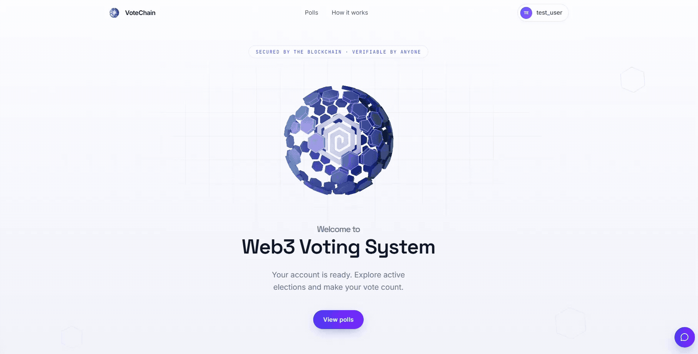
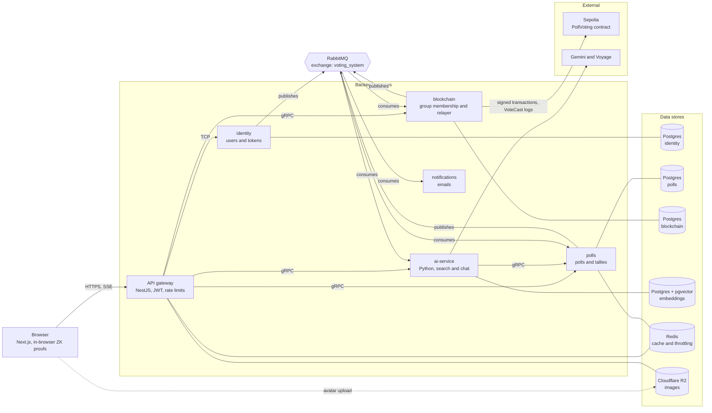
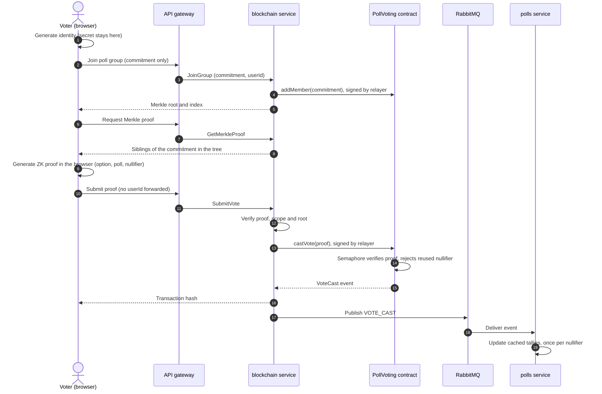

# Web3 Voting System

**Anonymous, verifiable polls on Ethereum.**
Every vote is a zero-knowledge proof: anyone can check the tally on-chain, and nobody can tell who voted for what.

 

## Table of contents

1. [About](#about)
2. [Highlights](#highlights)
3. [Architecture](#architecture)
4. [How anonymous voting works](#how-anonymous-voting-works)
5. [Features](#features)
6. [Under the hood](#under-the-hood)
7. [Testing and CI/CD](#testing-and-cicd)
8. [Running locally](#running-locally)
9. [Challenges and solutions](#challenges-and-solutions)
10. [What I learned](#what-i-learned)

## About

Web3 Voting System is a polling platform where voting is private by construction rather than by policy. You sign in with an ordinary account, pick a poll and vote. Your browser generates a [Semaphore](https://semaphore.pse.dev/) zero-knowledge proof that says "I am a registered member of this poll's group and I haven't voted yet" without saying which member. A relayer submits the proof to a smart contract on the Sepolia testnet, the contract verifies it, and the tally is updated. The platform can't link a vote to an account, and neither can anyone reading the chain.

It is also a deliberately broad portfolio project. It is built as a set of microservices that talk over different protocols (HTTP, TCP, gRPC, RabbitMQ), with a Solidity contract, a Python AI service and a full CI/CD pipeline around them, to show how these pieces fit together in one working system.

> The contracts live on the **Sepolia testnet** only. There is no real money involved and nothing here is audited for production elections.

## Highlights

- **Anonymous voting with zero-knowledge proofs.** Semaphore proofs are generated in the browser, so the server never sees which voting identity belongs to which account.
- **One vote per person, enforced.** Each account can join a poll's group once, and the contract rejects a reused nullifier, so double voting fails without revealing the voter.
- **Verifiable on-chain.** Every vote is a transaction you can open on Etherscan, and the tally in the app is derived from the contract's own events.
- **Six services, four protocols.** REST at the edge, TCP, gRPC and RabbitMQ pub/sub inside, each used where it fits the job.
- **AI-assisted polls.** Duplicate detection with pgvector, a neutrality check for loaded wording, natural-language search and a Q&A chat agent.
- **Cached and rate limited.** Redis cache-aside with version-based invalidation, and per-endpoint rate limits backed by a Lua script.
- **Tested end to end.** Unit, integration and Docker-backed e2e suites, plus Playwright runs that generate a real in-browser proof.
- **Shipped like a product.** Path-filtered CI, production images published to GHCR, tagged releases and a gated Sepolia deploy workflow.

## Architecture

The browser only ever talks to the API gateway. Behind it, each service owns one job and its own database, and the services find out about each other's work through RabbitMQ events.

### Services

| Service | Role | Talks over | Data |
|---|---|---|---|
| `frontend` | Next.js app, generates voting identities and ZK proofs in the browser | HTTP to the gateway | none |
| `api-gateway` | The only public entry point: REST, Swagger, JWT checks, validation, rate limiting, poll cover uploads | HTTP in, TCP and gRPC out | Redis, R2 |
| `identity` | Registration, login, Google OAuth, refresh tokens, profile, avatars | TCP | Postgres (Prisma), R2 |
| `polls` | Poll CRUD, listing and search filters, cached vote tallies | gRPC | Postgres (Prisma), Redis |
| `blockchain` | Semaphore group membership, proof verification, the relayer that signs every on-chain transaction, and the indexer that reads vote events back | gRPC | Postgres (Prisma), Sepolia |
| `ai-service` | Duplicate detection, neutrality check, natural-language search, Q&A agent | gRPC | Postgres with pgvector |
| `notifications` | Welcome emails, driven only by events | RabbitMQ consumer | none |
| `contracts` | `PollVoting.sol`, a thin wrapper around the Semaphore contract, shared by all polls | n/a | Sepolia |

### Events

The services that don't call each other directly are connected by a handful of events on one RabbitMQ topic exchange:

| Routing key | Published by | Consumed by | Effect |
|---|---|---|---|
| `USER_REGISTERED` | identity | notifications | Sends the welcome email |
| `POLL_CREATED` | polls | blockchain, ai-service | Creates the poll's on-chain group; indexes the poll's embedding |
| `POLL_CONTRACT_DEPLOYED` | blockchain | polls | Stores the contract address on the poll |
| `VOTE_CAST` | blockchain | polls | Updates the cached tallies, once per vote |

### Why the protocols differ

The mix is intentional. Part of the goal of the project is to show each style in a working system, so the choices are not claimed to be the only sensible ones.

- **REST** is what browsers speak, so it exists only at the gateway.
- **TCP** (Nest microservice transport) covers `identity`, a small request and response service where a typed contract buys little.
- **gRPC** with `.proto` files covers the services with richer contracts, including streaming for the chat answer, and it is what lets a Python service and a TypeScript one share a schema.
- **RabbitMQ** carries anything that is a fact about the past rather than a request, like "a poll was created". Several independent services react to the same event without the sender knowing about them.

The gateway is also the single JWT authority. Downstream services trust the `userId` it forwards, which keeps authentication logic in one place.

## How anonymous voting works

The short version: the platform knows **who is allowed to vote**, the blockchain knows **what was voted**, and nothing connects the two.

### The idea in plain English

1. **A secret you generate yourself.** The first time you vote in a poll, your browser creates a random [Semaphore](https://semaphore.pse.dev/) identity: a secret key plus a public fingerprint of it, called a commitment. The secret never leaves your browser.
2. **Joining the poll's group.** You send only the commitment to the server. It checks that your account hasn't joined this poll before (one account, one commitment per poll), and the relayer adds the commitment to the poll's group on the Sepolia contract. The group is a Merkle tree of everyone who may vote.
3. **Proving membership without revealing who you are.** Your browser builds a zero-knowledge proof that says "I know a secret whose commitment is somewhere in this group, and I choose option X". The proof doesn't say which member you are.
4. **Voting once.** The proof also carries a nullifier, a value derived from your secret and the poll. It is the same every time you vote in that poll and unlinkable to your commitment, so the contract can reject a second vote without knowing who cast the first.
5. **Anonymous sender.** The relayer, a single backend-owned account, submits the transaction. Every vote on every poll comes from the same address, so the sender tells you nothing about the voter.

### Vote flow

Two details that make this hold together:

- **Poll and option IDs become field elements.** Semaphore works with numbers in a finite field, not UUIDs. The poll ID becomes the proof's scope and the option ID becomes its message, converted by the same function in the browser and in the backend. If the two sides ever disagree, proof verification fails.
- **The Merkle tree is rebuilt from rows.** The `blockchain` service keeps each poll's tree in memory, but the source of truth is the `GroupMember` table, so a restart never invalidates the membership or the proofs already issued.

### What is and isn't private

| Private | Not hidden |
|---|---|
| Which commitment cast which vote | The result: every vote and its chosen option is public on-chain |
| Any link between an account and its vote | That an account joined a poll's group, because the server stores the account to commitment link to enforce one vote per person |
| The identity secret, which never leaves the browser | Timing: joining and voting happen seconds apart from the same session, which matters in small groups |
| The voter's own address, since the relayer sends everything | The relayer: a malicious operator could log IP addresses and request times |

Other honest limits:

- **The voting identity lives in `localStorage`.** Clearing site data, or switching browser, after joining means you can't vote in that poll any more, since your account has already used its one slot.
- **Small groups give weak anonymity.** A group with one member is trivially identifiable. The guarantee gets stronger as more people join.
- **Sepolia testnet only.** The contracts are the standard Semaphore ones plus a thin owner-restricted wrapper, but nothing here has been audited.
